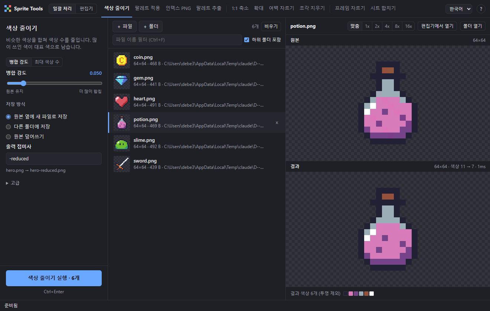
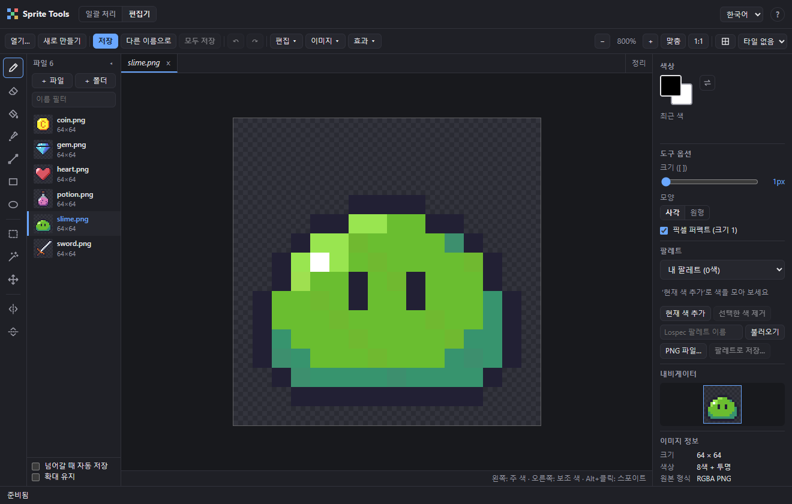
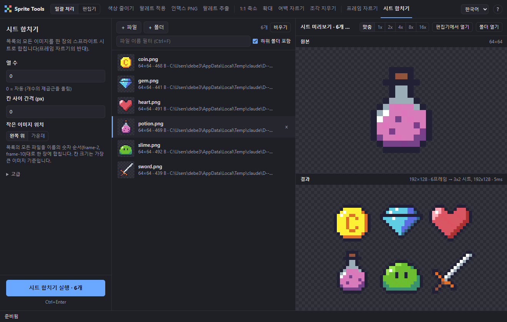

# sprite-tools

[English](README.md) | 한국어

픽셀 아트 PNG를 일괄 처리하는 도구입니다. 명령줄(CLI)과 GUI 두 가지로 쓸 수 있으며, 둘은 같은 처리 코드를 공유합니다.

```
go build -o sprite-tools.exe .
sprite-tools help
```

## GUI

`gui/` 폴더에 [Wails](https://wails.io) 기반 데스크톱 앱이 있습니다.

| 일괄 처리 | 편집기 |
| --- | --- |
|  |  |



```
cd gui
wails build        # → gui/build/bin/sprite-tools-gui.exe
wails dev          # 개발 모드 (화면 수정 시 자동 갱신)
```

- PNG 파일이나 폴더를 창에 끌어다 놓아 추가 (하위 폴더 포함 여부 선택)
- 위쪽 탭: 색상 줄이기 · 팔레트 적용 · 인덱스 PNG · 팔레트 추출 | 1:1 축소 · 확대 · 여백 자르기 · 조각 지우기 | 프레임 자르기 · 시트 합치기
- 조각 지우기: 투명하지 않은 픽셀이 이어진 덩어리 중 기준(기본 4픽셀)보다 작은 것을 투명하게 지워 남은 얼룩을 정리합니다. 대각선 포함(8방향) 선택, 미리보기 지원, 지울 조각이 없으면 건너뜀
- 원본/결과 미리보기: 옵션을 바꾸면 바로 갱신되며, 픽셀이 뭉개지지 않게 정수 배율로 확대
- 결과 색상 견본, 팔레트 견본, Lospec 팔레트 불러오기
- 저장 방식: 원본 옆에 새 파일 / 다른 폴더에 저장(폴더에서 찾은 파일은 하위 폴더 구조 유지, 접미사는 비워도 됨) / 원본 덮어쓰기
- 팔레트 추출: 결과 칸에 추출된 색 견본이 보이며, 이름을 주면 '팔레트 적용'의 팔레트 목록에도 바로 저장
- 시트 합치기: 목록의 모든 파일을 이름의 숫자 순서(frame-2, frame-10)로 합친 시트를 미리보고, 실행하면 저장 위치를 물어봄
- 원본 덮어쓰기 전 백업(기본 켜짐): 각 파일 옆 `.sprite-tools-backup/<실행 시각>/` 에 원본을 복사해 두고, 실행이 끝난 알림의 `되돌리기` 로 한 번에 복원 (`백업 폴더 열기` 도 제공). 건너뛰거나 실패한 파일의 백업은 남기지 않음
- 미리보기 검사: 원본/결과 위에 마우스를 올리면 캡션에 픽셀 좌표 `x, y` 와 색상 `#rrggbb`·알파 표시. 결과 창을 누르고 있거나 `Space` 를 누르는 동안 원본을 보여주는 비교, 확대 시 두 창의 스크롤 동기화, `Ctrl+휠` 로 확대 단계(맞춤 · 1x · 2x · 4x · 8x · 16x) 변경
- 파일 목록 필터: 이름으로 걸러 보기(`Ctrl+F`, `Esc` 로 지움). 필터 중에도 실행은 기본적으로 목록 전체이며(버튼에 `전체 n개` 표시), `보이는 n개만 실행` 을 체크하면 보이는 파일만 처리
- 실행 후 알림의 `결과를 목록에 추가` 로 만들어진 파일(프레임 자르기·시트 합치기 결과 포함)을 바로 목록에 추가
- 진행률 표시, 취소(Esc), 결과 폴더 열기
- 단축키: `Ctrl+Enter` 실행, `Esc` 취소/닫기, `Alt+1~9`, `Alt+0`(열 번째) 탭 순서대로 명령 전환, `↑/↓` 파일 이동, `Delete` 목록에서 제거, `Ctrl+F` 파일 필터, `Space` 누르는 동안 원본 비교, `Ctrl+휠` 확대, `F1`/`?` 단축키 도움말 (상단 `?` 버튼도 같음)
- 설정은 다음 실행 때도 유지됩니다
- 언어: 위쪽 막대 오른쪽의 언어 선택(English · 한국어)에서 바꿉니다. 처음 실행하면 영어이고(운영체제 언어는 따르지 않음) 선택은 다음 실행 때도 유지됩니다. 화면 글자뿐 아니라 처리 결과 메시지·오류·파일 선택 대화상자 같은 Go 쪽 문구도 함께 바뀝니다

### 편집기

위쪽 `편집기` 탭(또는 `Ctrl+2`)에서 PNG 를 직접 고칠 수 있습니다. 여러 파일을 열어 두고 연달아 고치는 작업을 염두에 두었으며, 왼쪽 파일 띠에서 고르거나 목록의 파일을 더블클릭하거나 `열기…` / `새로 만들기` 로 시작합니다. 픽셀은 Go에서 정밀한 RGBA로 읽고 쓰며, 원본이 인덱스 PNG였고 색이 256개 이하면 저장할 때도 인덱스 PNG(팔레트 순서 유지)로 저장합니다.

- 도구: 연필(`B`) · 지우개(`E`) · 채우기(`G`, 이어진 영역/전체 같은 색, 허용 오차) · 스포이트(`I`, 어느 도구에서나 `Alt`+클릭) · 선(`L`) · 사각형(`U`) · 타원(`Shift+U`) · 사각형 선택(`M`) · 마법봉(`W`) · 이동(`V`). 브러시 크기 `[` `]`, 사각/원형 브러시, 픽셀 퍼펙트, 가로/세로 대칭 그리기. 왼쪽 버튼은 주 색, 오른쪽 버튼은 보조 색(`X` 로 교체)
- 선택 영역: 드래그로 선택, `Shift` 더하기 · `Alt` 빼기(마스크 방식이라 모양이 사각형이 아니어도 됨), `Ctrl+A` 전체 · `Ctrl+D` 해제 · `Ctrl+Shift+I` 반전, 움직이는 점선 윤곽선. 선택이 있으면 모든 그리기 도구가 선택된 픽셀만 바꿉니다
- 마법봉(`W`): 클릭한 픽셀과 같은 색인 이어진 영역(기본 상하좌우 4방향, 옵션으로 대각선까지 8방향)을 선택합니다. `전체 같은 색` 을 켜면 이어지지 않아도 이미지 전체의 같은 색을 선택하고, 허용 오차 슬라이더는 채우기와 공유합니다(0 = 정확히 같은 색). 완전히 투명한 픽셀(알파 0)은 RGB 와 상관없이 모두 같은 색으로 봅니다. `Shift` 더하기 · `Alt` 빼기, 이미지 밖 클릭은 선택 해제. 만들어진 선택은 사각형 선택과 같은 마스크라서 `Delete` · 이동 · 복사 · 이미지 메뉴가 그대로 동작합니다 (남은 얼룩 지우기: `W` → 얼룩 클릭 → `Delete`)
- 이동·클립보드: 선택 안쪽을 끌거나 이동 도구·방향키(`Shift` 10px)로 옮기면 선택한 픽셀이 떠 있는 층이 되고, `Enter`/바깥 클릭으로 확정(실행 취소 한 단계), `Esc` 로 취소. `Ctrl+C` / `Ctrl+X` / `Ctrl+V`(붙여넣으면 떠 있는 선택), `Delete` 로 선택 픽셀 지우기. 클립보드는 앱 안에서만 쓰입니다
- 이미지 메뉴: 가로/세로 뒤집기(`Shift+H` / `Shift+V`), 90° 회전·180° 회전(선택이 있으면 선택한 픽셀만 중심 기준으로), 캔버스 크기(9방향 기준점), 선택 영역으로 자르기, 여백 자르기(`trim` 과 같은 기준)
- 효과 메뉴: 색상 줄이기(병합 강도/최대 색상 수) · 팔레트 적용 · 1:1 축소 · 확대 · 작은 조각 지우기를 현재 이미지에 적용합니다. 일괄 처리와 같은 처리 코드를 쓰며, 옵션을 바꿀 때마다 캔버스에 미리 보고(`원본 보기` 로 비교), `확인`/`취소` 로 적용하거나 되돌립니다. 결과는 실행 취소 한 단계. 작은 조각 지우기만은 선택 영역이 있으면 그 안쪽 픽셀만 지웁니다(조각은 이미지 전체에서 찾고, 처리 결과와 원본을 선택 마스크로 합쳐 적용). 나머지 효과는 선택과 상관없이 이미지 전체에 적용됩니다
- 팔레트 패널: 내 팔레트(`현재 색 추가`/`선택한 색 제거`, 다음 실행 때도 유지) · `이미지에서`(많이 쓴 색 순, 최대 256색) · 저장된 팔레트 · Lospec 이름으로 불러오기 · PNG 파일. 왼쪽 클릭 = 주 색, 오른쪽 클릭 = 보조 색, 마우스를 올리면 hex 표시, 주 색과 같은 칸은 강조. `팔레트로 저장…` 은 `extract -save` 와 같은 팔레트 폴더에 저장하므로 일괄 처리의 `팔레트 적용`에서도 바로 보입니다(같은 이름은 확인 후 덮어쓰기)
- 보기: 확대/축소(`Ctrl+휠`, `+` `-`, `0` 맞춤, `1` 100%), `Space`+드래그 이동, 픽셀 격자(`#`), 타일 격자, 내비게이터
- 파일: `Ctrl+O` 열기 · `Ctrl+N` 새로 만들기 · `Ctrl+S` 저장 · `Ctrl+Shift+S` 다른 이름으로(덮어쓰기 전 원본 백업 선택 가능). `Ctrl+Z` / `Ctrl+Y` 로 실행 취소(문서마다 최대 200단계)

#### 여러 파일 연속 작업

- 문서(탭): 열어 둔 이미지마다 픽셀·크기·실행 취소 기록·선택·확대/위치·저장 상태를 따로 가지므로, 저장하지 않고도 즉시 오갈 수 있습니다. 도구·색·도구 옵션·팔레트·격자 설정은 모든 문서가 공유합니다. 캔버스 위 탭에는 이름, 저장하지 않은 변경 표시(●), 닫기(×)가 있고 가운데 버튼·`Ctrl+W` 로 닫습니다(고친 문서는 저장 / 저장 안 함 / 취소를 물음). `Ctrl+Tab` / `Ctrl+Shift+Tab` 으로 탭을 순환하고, 탭이 많으면 가로로 스크롤되며 현재 탭이 항상 보입니다. `정리` 버튼은 수정하지 않은 탭을 한꺼번에 닫습니다. 문서를 바꿀 때 떠 있는 층은 확정됩니다
- 미리보기 탭: 파일 띠에서 클릭하거나 `PageDown` 등으로 연 파일은 이탤릭 `미리보기 탭` 이 됩니다. 수정하지 않았다면 다음에 같은 방식으로 여는 파일이 그 탭을 대신하므로 파일 100개를 훑어도 탭이 쌓이지 않습니다. 고치면(떠 있는 층 포함) 자동으로 고정되어 계속 남고, 탭이나 파일 띠 항목을 더블클릭해도 고정됩니다. `열기…`·`새로 만들기` 로 연 문서는 처음부터 고정됩니다
- 파일 띠: 도구 막대 오른쪽의 접을 수 있는 목록으로 **일괄 처리 목록과 같은 파일**(오류 파일 제외)을 썸네일로 보여 주며, 현재 파일 강조 · 열려 있는 파일(파란 이름) · 저장 안 한 변경(●) 표시와 이름 필터(일괄 처리의 필터와 같은 값)가 있습니다. `＋ 파일` / `＋ 폴더` 를 누르거나 편집기에 파일·폴더를 끌어다 놓으면 공유 목록에 더해지고 첫 파일이 열립니다. 일괄 처리에서 목록을 바꾸면 띠에도 바로 반영되고(반대도 마찬가지), 목록에서 지워도 고친 채 열려 있는 문서는 탭으로 남습니다
- 이동: `PageDown` / `PageUp` 또는 `Alt+→` / `Alt+←` 로 띠 순서의 다음·이전 파일을 엽니다(어느 도구에서나, 글자를 입력하는 칸에서는 제외). 끝에서는 `마지막 파일입니다` 알림만 나옵니다. 파일 띠 아래의 옵션: `넘어갈 때 자동 저장`(고친 파일을 먼저 저장하고 넘어감, 백업 설정 적용, 저장 실패 시 넘어가지 않음) · `확대 유지`(새로 연 파일에 이전 파일의 확대 배율을 그대로 사용하고, 크기가 같으면 위치도 유지). 두 옵션은 다음 실행 때도 유지됩니다
- 모두 저장(`Ctrl+Alt+S`): 저장하지 않은 문서를 모두 저장하고 개수·백업 수를 알립니다. 경로가 없는 새 문서(제목 없음)는 저장 대화상자를 연달아 띄우지 않고 건너뛰며, 알림의 `건너뛴 문서 저장…` 으로 따로 저장할 수 있습니다. 하나가 실패해도 나머지는 계속 저장하고, 저장한 파일은 일괄 처리 목록의 크기·썸네일도 갱신됩니다
- 실행 취소 기록은 열린 문서가 메모리 256MB 를 나눠 씁니다. 넘치면 가장 오래 쓰지 않은 문서의 오래된 단계부터 버리며(저장 상태는 유지), 문서마다 최대 200단계입니다
- 창을 닫을 때는 `저장하지 않은 문서 N개` 로 한 번 더 확인하고, 상단 `편집기` 탭의 ●도 하나라도 고친 문서가 있으면 켜집니다

빌드에는 Go, Node.js, Wails CLI(`go install github.com/wailsapp/wails/v2/cmd/wails@latest`)가 필요하며, 실행에는 WebView2(Windows 10/11 기본 포함)가 필요합니다.

## 명령

| 명령 | 별칭 | 설명 | 기본 출력 |
| --- | --- | --- | --- |
| `reduce` | `rd` | 비슷한 색상을 합쳐 색상 수를 줄임 (`-t` 로 강도 조절, `-k 16` 으로 최대 색상 수 지정) | `*-reduced.png` |
| `recolor` | `rc` | Lospec 팔레트 또는 팔레트 PNG의 색으로 변환 (`-p`) | `*-recolored.png` |
| `index` | `ix` | 인덱스(팔레트) PNG로 변환, 0번 색을 투명으로 고정 | `*-indexed.png` |
| `extract` | `ex` | 이미지의 색을 팔레트 PNG(색 1개 = 1px, 한 줄)로 추출. 많이 쓴 색 순, 256색 초과 시 실패. `-save <이름>` 으로 팔레트 폴더에도 저장 | `*-palette.png` |
| `downscale` | `ds` | 확대된 픽셀 아트를 1:1로 축소 (자동 감지, `-scale` 로 지정) | `*-downscaled.png` |
| `upscale` | `us` | 정수 배율 최근접 확대 (`-scale 2~32`, 기본 2) | `*-upscaled.png` |
| `trim` | `tr` | 투명한 바깥 여백을 잘라냄 (`-pad N` 으로 사방에 투명 여백 추가) | `*-trimmed.png` |
| `despeckle` | `dsp` | 떨어져 있는 작은 조각(얼룩)을 투명하게 지움. 이어진 덩어리가 `-min N`(기본 4)픽셀보다 작으면 제거, `-diagonal=false` 로 대각선 연결을 끌 수 있음 | `*-clean.png` |
| `slice` | `sl` | 스프라이트 시트를 프레임으로 자름 (`-size 16` / `-size 16x24`) | `*-0001.png` … |
| `pack` | `pk` | 여러 이미지를 한 장의 시트로 합침 (`slice` 의 반대). `-cols`, `-gap`, `-align center`, 출력 `-o <파일.png>` 필수 | `-o` 로 지정한 파일 |

명령은 별칭 외에도 겹치지 않는 앞부분으로 줄여 쓸 수 있습니다 (`red` → reduce, `dow` → downscale, `de` → despeckle). `d` 는 downscale 과 despeckle 에 모두 맞아 더는 쓸 수 없고, `ds` 는 downscale · `dsp` 는 despeckle 의 별칭입니다.
이전 이름(`simplify`, `split`, `palette`, `palette-convert`)도 계속 동작합니다.

## 언어

기본 언어는 영어입니다. 운영체제 언어는 자동으로 따르지 않습니다.

- CLI: `--lang ko` (명령 앞뒤 어디에 써도 됨) 또는 환경 변수 `SPRITE_TOOLS_LANG=ko`. 둘 다 있으면 `--lang` 이 우선합니다. 도움말·진행 상황·요약·오류가 모두 선택한 언어로 나옵니다.
- GUI: 위쪽 막대의 언어 선택. 선택은 저장되어 다음 실행 때도 유지됩니다.
- 언어 추가: [docs/TRANSLATING.md](docs/TRANSLATING.md)를 보세요 (영어 문서). 번역 파일(JSON) 두 개를 더하면 됩니다.

## 공통 옵션

`pack` 을 뺀 파일별 명령(reduce, recolor, index, extract, downscale, upscale, trim, despeckle)에 해당합니다.

- `[경로...]` 파일·폴더를 여러 개 지정 가능. 생략하면 현재 폴더의 PNG.
- `-i` 폴더 탐색 시 파일 이름 패턴 (기본 `*.png`)
- `-r` 하위 폴더까지 탐색
- `-s` 출력 파일 접미사 / `-w` 원본 덮어쓰기 (`extract` 는 `-w` 없음)
- `-backup` `-w` 로 덮어쓰기 전에 원본을 `<파일 폴더>/.sprite-tools-backup/<실행 시각 YYYYMMDD-HHMMSS>/<이름>` 에 복사 (`-w` 와 함께 쓰기를 권장, 기본은 꺼짐). 건너뛰거나 실패한 파일의 백업은 지우며, 백업이 남은 폴더는 종료 시 요약에 출력. 숨김 폴더(`.` 시작)라 이후 탐색에서 제외됨. 되돌리려면 백업 파일을 원래 자리로 복사
- `-o <폴더>` 결과를 다른 폴더에 저장. 폴더로 지정한 경로 아래에서 찾은 파일은 그 폴더 기준의 하위 경로를 유지하고(같은 이름이 달라도 겹치지 않음), 파일로 직접 지정한 경우에는 출력 폴더 바로 아래에 저장. 폴더는 자동으로 만들며 `-w` 와는 함께 쓸 수 없음.
  접미사는 비워도 되지만(`-s ""`), 출력이 원본과 같은 경로가 되는 파일은 실패로 처리해 원본을 지키며, 출력 폴더 안쪽 파일은 탐색에서 제외
- `-n` 실제 처리 없이 대상 파일과 실제 출력 경로만 미리보기
- `-j` 동시 처리 스레드 수

(`slice` 의 `-o` 는 프레임을 저장할 폴더이고, `pack` 의 `-o` 는 저장할 시트 파일입니다.)

이전 실행의 출력 파일(같은 접미사)은 자동으로 대상에서 제외되며, 저장은 임시 파일을 거쳐 원자적으로 이뤄집니다.
처리 중 실패한 파일이 있으면 종료 코드 1, 잘못된 사용법이면 2를 반환합니다.

## pack

```
sprite-tools pack frames -o sheet.png                   # 폴더의 모든 PNG
sprite-tools pk frames -cols 4 -gap 1 -align center -o sheet.png
```

- 입력은 자연 정렬 순서(`frame-2` < `frame-10`)로 합치며, 칸 크기는 가장 큰 너비 × 가장 큰 높이입니다. 작은 이미지는 칸의 왼쪽 위(`-align center` 면 가운데)에 놓입니다.
- `-cols 0` 이면 개수의 제곱근을 올림한 열 수, `-gap` 은 칸 사이 투명 간격입니다.
- 입력 파일을 덮어쓰는 출력은 항상 거부하고, 이미 있는 다른 파일은 `-force` 가 있어야 덮어씁니다. 폴더를 훑다가 같은 출력 파일이 잡히면 입력에서 뺍니다.
- 완료되면 `12프레임 → 4x3 시트, 64x48` 처럼 요약을 출력합니다.

## 예시

```
sprite-tools rd hero.png -t 0.08
sprite-tools ds assets -r -w
sprite-tools us sprites -r -scale 4 -o big
sprite-tools tr sprites -r -pad 1 -o trimmed -n
sprite-tools dsp sprites -r -min 8 -w -backup
sprite-tools sl sheet.png -size 32 -o frames
sprite-tools pk frames -o sheet.png
sprite-tools ex hero.png -save hero-colors
sprite-tools rc -p hero-colors enemy.png
sprite-tools rc -p otterisk-96 -n
```

다운로드하거나 `extract -save` 로 저장한 팔레트는 사용자 폴더(`%APPDATA%\sprite-tools\palettes`)에 보관되어 CLI와 GUI가 함께 씁니다. 실행 파일 옆에 `palettes/` 폴더가 있으면 그쪽도 함께 찾습니다 (`recolor -list`).
