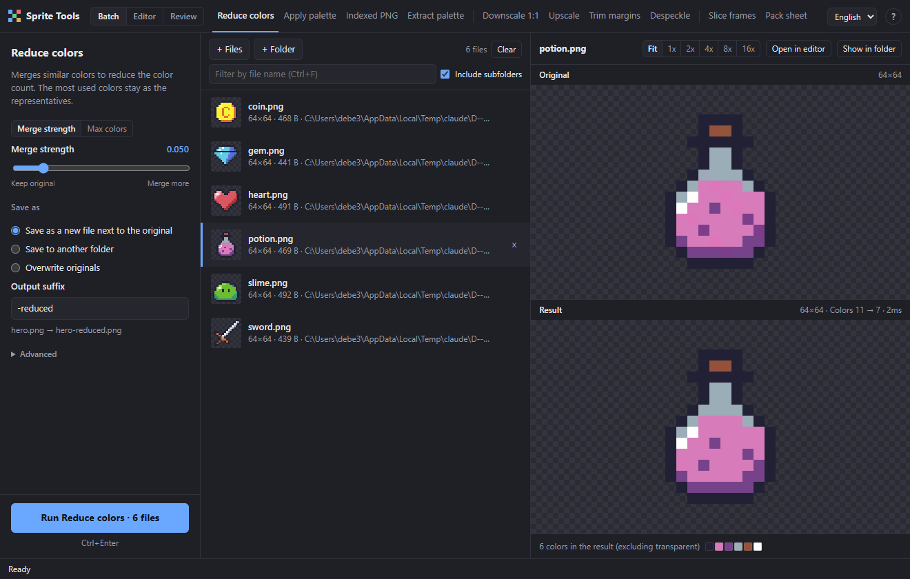
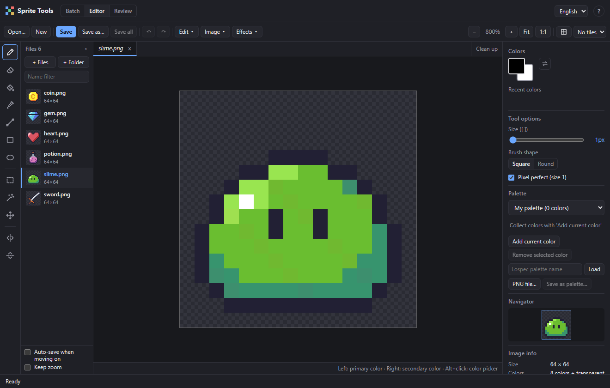
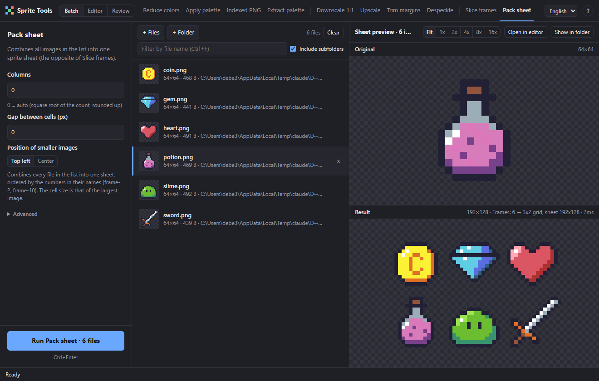
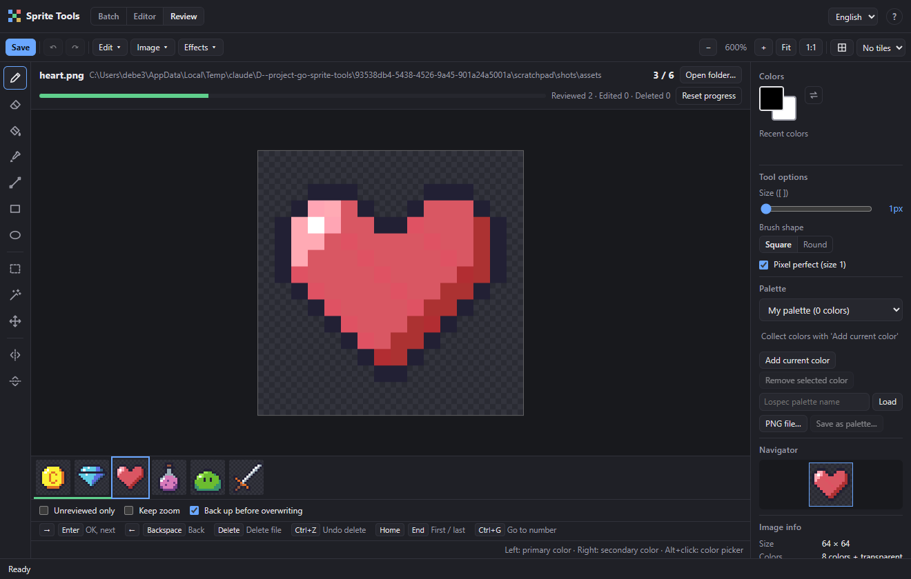

# sprite-tools

English | [한국어](README.ko.md)

A tool for batch-processing pixel art PNGs. It comes as a command-line tool (CLI) and as a GUI, and both share the same processing code.

```
go build -o sprite-tools.exe .
sprite-tools help
```

## GUI

The `gui/` folder contains a desktop app based on [Wails](https://wails.io).

| Batch | Editor |
| --- | --- |
|  |  |



```
cd gui
wails build        # → gui/build/bin/sprite-tools-gui.exe
wails dev          # development mode (the UI refreshes when you edit it)
```

- Drag PNG files or folders onto the window to add them (subfolders can be included or not)
- Tabs along the top: Reduce colors · Apply palette · Indexed PNG · Extract palette | Downscale 1:1 · Upscale · Trim margins · Despeckle | Slice frames · Pack sheet
- Despeckle: erases connected groups of non-transparent pixels that are smaller than a threshold (4 pixels by default) to clean up leftover specks. Diagonal neighbors (8-way) can be counted as connected, the result can be previewed, and images with nothing to erase are skipped
- Original/result preview: updates immediately when you change an option, and is enlarged by integer factors so pixels are never blurred
- Result color swatches, palette swatches, loading palettes from Lospec
- Save modes: as a new file next to the original / to another folder (files found in a folder keep their subfolder structure, the suffix may be empty) / overwrite the original
- Extract palette: the extracted color swatches appear in the result pane, and if you give a name the palette is saved straight to the palette list of 'Apply palette'
- Pack sheet: previews a sheet made of all files in the list, ordered by the numbers in their names (frame-2, frame-10); running it asks where to save
- Backup before overwriting (on by default): copies each original into `.sprite-tools-backup/<run time>/` next to the file, and the notification after the run offers `Undo` to restore everything at once (plus `Open backup folder`). Backups of skipped or failed files are not kept
- Preview inspection: hover over the original/result to see the pixel coordinates `x, y` and the color `#rrggbb` with alpha in the caption. Holding the result pane or pressing `Space` shows the original for comparison, the two panes scroll together when zoomed, and `Ctrl`+wheel changes the zoom step (Fit · 1x · 2x · 4x · 8x · 16x)
- File list filter: narrow the list by name (`Ctrl+F`, `Esc` clears it). Running still processes the whole list by default while a filter is active (the button shows `all n files`); tick `Run on the n visible files only` to process just the visible ones
- `Add result to list` in the notification after a run adds the files that were created (including the results of Slice frames and Pack sheet) to the list
- Progress display, cancel (Esc), open the result folder
- Shortcuts: `Ctrl+Enter` run, `Esc` cancel/close, `Alt+1~9` and `Alt+0` (tenth) switch command in tab order, `↑/↓` move between files, `Delete` remove from the list, `Ctrl+F` file filter, `Space` hold to compare with the original, `Ctrl`+wheel zoom, `F1`/`?` shortcut help (the `?` button in the top bar does the same)
- Settings are kept for the next launch
- Language: change it with the language selector at the right of the top bar (English · 한국어). The first launch is in English (the operating system language is not followed) and the choice is remembered. Besides the on-screen text, the texts produced by the Go side — result messages, errors and native file dialogs — change too

### Editor

Open the `Editor` tab at the top (or press `Ctrl+2`) to edit PNGs directly. It is designed for opening several files and working through them one after another: pick a file from the file strip on the left, double-click a file in the list, or start with `Open…` / `New`. Pixels are read and written as exact RGBA in Go, and if the original was an indexed PNG with 256 colors or fewer it is saved as an indexed PNG again (palette order preserved).

- Tools: Pencil (`B`) · Eraser (`E`) · Fill (`G`, contiguous / all same color, tolerance) · Color picker (`I`, or `Alt`+click from any tool) · Line (`L`) · Rectangle (`U`) · Ellipse (`Shift+U`) · Rectangle select (`M`) · Magic wand (`W`) · Move (`V`). Brush size `[` `]`, square/round brush, pixel perfect, horizontal/vertical symmetry drawing. The left button draws with the primary color, the right button with the secondary color (`X` swaps them)
- Selection: drag to select, `Shift` adds · `Alt` subtracts (it is a mask, so the shape need not be a rectangle), `Ctrl+A` select all · `Ctrl+D` deselect · `Ctrl+Shift+I` invert, with an animated dashed outline. While a selection exists, every drawing tool only changes the selected pixels
- Magic wand (`W`): selects the contiguous area of the clicked pixel's color (4-way by default, 8-way with the diagonal option). With `All same color` it selects every pixel of that color in the image, contiguous or not, and the tolerance slider is shared with Fill (0 = exactly the same color). Fully transparent pixels (alpha 0) all count as the same color regardless of RGB. `Shift` adds · `Alt` subtracts, and clicking outside the image deselects. The selection is the same mask as a rectangle selection, so `Delete`, move, copy and the Image menu work as usual (to erase leftover specks: `W` → click the speck → `Delete`)
- Move and clipboard: dragging inside the selection, or using the Move tool or the arrow keys (`Shift` for 10px), turns the selected pixels into a floating layer; `Enter` or a click outside commits it (one undo step), `Esc` cancels. `Ctrl+C` / `Ctrl+X` / `Ctrl+V` (a paste becomes a floating selection), `Delete` clears the selected pixels. The clipboard works only inside the app
- Image menu: flip horizontally/vertically (`Shift+H` / `Shift+V`), rotate 90° / 180° (with a selection, only the selected pixels, around their center), canvas size (9 anchor points), crop to selection, trim margins (same rule as `trim`)
- Effects menu: applies Reduce colors (merge strength / max colors) · Apply palette · Downscale 1:1 · Upscale · Despeckle to the current image. It uses the same processing code as batch mode; every option change is previewed on the canvas (compare with `Show original`), and `OK` / `Cancel` applies or reverts it. The result is one undo step. Only Despeckle respects the selection: with a selection, only pixels inside it are erased (pieces are still found across the whole image, and the processed result and the original are combined through the selection mask). The other effects apply to the whole image regardless of the selection
- Palette panel: My palette (`Add current color` / `Remove selected color`, kept for the next launch) · `From image` (most used colors first, up to 256) · saved palettes · load by Lospec name · PNG file. Left click = primary color, right click = secondary color, hovering shows the hex value, and the swatch equal to the primary color is highlighted. `Save as palette…` saves to the same palette folder as `extract -save`, so the palette also shows up right away in `Apply palette` in batch mode (an existing name is overwritten after confirmation)
- View: zoom (`Ctrl`+wheel, `+` `-`, `0` fit, `1` 100%), `Space`+drag to pan, pixel grid (`#`), tile grid, navigator
- Files: `Ctrl+O` open · `Ctrl+N` new · `Ctrl+S` save · `Ctrl+Shift+S` save as (the original can be backed up before overwriting). `Ctrl+Z` / `Ctrl+Y` undo/redo (up to 200 steps per document)

#### Working through several files

- Documents (tabs): every open image keeps its own pixels, size, undo history, selection, zoom/position and saved state, so you can switch between them instantly without saving. Tools, colors, tool options, the palette and grid settings are shared by all documents. A tab above the canvas has the name, an unsaved-changes mark (●) and a close button (×); close it with the middle button or `Ctrl+W` (a modified document asks to save / don't save / cancel). `Ctrl+Tab` / `Ctrl+Shift+Tab` cycle through the tabs; with many tabs the bar scrolls horizontally and the current tab always stays visible. The `Clean up` button closes all unmodified tabs at once. A floating layer is committed when you switch documents
- Preview tabs: a file opened by clicking in the file strip, with `PageDown` and so on, becomes an italic preview tab. As long as you have not modified it, the next file opened the same way takes its place, so browsing 100 files does not pile up tabs. Modifying it (including a floating layer) keeps it automatically, and double-clicking the tab or the file strip entry keeps it too. Documents opened with `Open…` or `New` are kept from the start
- File strip: a collapsible list to the right of the toolbar that shows **the same files as the batch list** (files with errors excluded) as thumbnails, with the current file highlighted, open files (blue name), an unsaved-changes mark (●) and a name filter (the same value as the filter in batch mode). Press `+ Files` / `+ Folder`, or drop files or folders on the editor, to add them to the shared list and open the first one. Changing the list in batch mode is reflected in the strip right away (and vice versa); a modified document that is still open stays as a tab even if you remove it from the list
- Moving on: `PageDown` / `PageUp` or `Alt+→` / `Alt+←` open the next/previous file in strip order (from any tool, except while typing in a text field). At either end you only get the `This is the last file` notice. Options below the file strip: `Auto-save when moving on` (saves a modified file first and then moves on; the backup setting applies, and it does not move on if saving fails) · `Keep zoom` (a newly opened file uses the previous file's zoom, and the position too if the size is the same). Both options are kept for the next launch
- Save all (`Ctrl+Alt+S`): saves every unsaved document and reports how many were saved and backed up. New documents without a path (Untitled) are skipped instead of opening a series of save dialogs, and the `Save skipped documents…` button in the notification lets you save them separately. If one fails the others are still saved, and saved files also refresh their size and thumbnail in the batch list
- The undo history of all open documents shares 256MB of memory. When it overflows, the oldest steps of the least recently used document are dropped first (the saved state is preserved), and each document keeps at most 200 steps
- Closing the window asks once more with `N unsaved documents`, and the ● on the top `Editor` tab lights up if any document has been modified

### Review mode



Open the `Review` tab (or press `Ctrl+3`) to go through **thousands** of images quickly: look, fix if needed, move on if fine, delete the bad ones. It reviews the batch list (files with errors excluded; the name filter applies), or press `Open folder…` to review another folder. One image is shown at a time, with the editor's tools, effects and palette still available, a progress bar, counters (reviewed / edited / deleted) and a filmstrip of thumbnails around the current image (click one to jump).

| Key | Action |
|---|---|
| `→` `Enter` `PageDown` | Mark as OK and go to the next image. A modified image is saved first (the backup setting applies); if saving fails you stay on it |
| `←` `Backspace` `PageUp` | Previous image (status unchanged) |
| `Delete` | Move the file to the trash folder and show the next image. With a selection or floating layer it clears the selected pixels as usual |
| `Shift+Delete` | Always delete the file, even with a selection |
| `Ctrl+Z` | Undo the last deletion (when nothing was edited since); otherwise a normal pixel undo. The notice also has an `Undo delete` button |
| `Home` `End` `Ctrl+G` | First · last image · go to an image number |
| `Ctrl+O` | Open a folder |

With a selection the arrow keys still nudge it, and the tool keys (`B E G I L U M W V X [ ]`) keep working. `Unreviewed only` skips what you have already reviewed.

- **Deleting is safe.** A deleted file is moved to a hidden `.sprite-tools-trash` folder next to it (instant, reversible, skipped by scans); the app never deletes anything permanently. When you leave Review you are asked whether to move the trash to the Windows Recycle Bin (`Move to Recycle Bin` / `Keep for now` / `Show`), and the `Recycle deleted (N)` button in the bar does the same at any time. If Windows cannot recycle a file it asks before destroying it.
- **Backups.** When `Back up before overwriting` is checked (it is visible in the bar), saving an edited image over the original makes a backup each time. Editing thousands of images therefore creates thousands of backups in `.sprite-tools-backup` folders; uncheck it if you do not need them.
- **Progress is remembered** per folder (the common folder of the files) in the app's local storage: which images were reviewed or edited, the deleted count and the position. Reopening the same folder resumes at the last position automatically (the notice has `Start over`); `Reset progress` forgets it.
- Speed: the next and previous images are decoded ahead of time, and the file lists (batch list, editor file strip, filmstrip) only draw the rows that are visible, so 3,000+ files stay responsive.

Building requires Go, Node.js and the Wails CLI (`go install github.com/wailsapp/wails/v2/cmd/wails@latest`), and running requires WebView2 (included by default in Windows 10/11).

## Commands

| Command | Alias | Description | Default output |
| --- | --- | --- | --- |
| `reduce` | `rd` | Merges similar colors to reduce the color count (`-t` sets the strength, `-k 16` sets the max number of colors) | `*-reduced.png` |
| `recolor` | `rc` | Converts to the colors of a Lospec palette or a palette PNG (`-p`) | `*-recolored.png` |
| `index` | `ix` | Converts to an indexed (palette) PNG and fixes color 0 as transparent | `*-indexed.png` |
| `extract` | `ex` | Extracts the image's colors into a palette PNG (1 color = 1px, a single row). Most used colors first; fails above 256 colors. `-save <name>` also saves it to the palette folder | `*-palette.png` |
| `downscale` | `ds` | Scales enlarged pixel art back down 1:1 (auto-detected, or set with `-scale`) | `*-downscaled.png` |
| `upscale` | `us` | Integer nearest-neighbor enlargement (`-scale 2~32`, default 2) | `*-upscaled.png` |
| `trim` | `tr` | Crops the transparent outer margin (`-pad N` adds a transparent margin on every side) | `*-trimmed.png` |
| `despeckle` | `dsp` | Erases small detached pieces (specks). A connected group smaller than `-min N` (default 4) pixels is removed; `-diagonal=false` turns off diagonal connections | `*-clean.png` |
| `slice` | `sl` | Cuts a sprite sheet into frames (`-size 16` / `-size 16x24`) | `*-0001.png` … |
| `pack` | `pk` | Combines several images into one sheet (the opposite of `slice`). `-cols`, `-gap`, `-align center`, and the output `-o <file.png>` is required | the file given with `-o` |

Besides the aliases, a command can be shortened to any prefix that is unambiguous (`red` → reduce, `dow` → downscale, `de` → despeckle). `d` matches both downscale and despeckle and can no longer be used; `ds` is the alias of downscale and `dsp` the alias of despeckle.
The old names (`simplify`, `split`, `palette`, `palette-convert`) still work.

## Language

The default language is English. The operating system language is not detected automatically.

- CLI: `--lang ko` (anywhere before or after the command) or the environment variable `SPRITE_TOOLS_LANG=ko`. If both are given, `--lang` wins. Help, progress, summaries and errors all appear in the chosen language.
- GUI: the language selector in the top bar. The choice is saved and kept for the next launch.
- Adding a language: see [docs/TRANSLATING.md](docs/TRANSLATING.md). It takes two translation files (JSON).

## Common options

These apply to the per-file commands (reduce, recolor, index, extract, downscale, upscale, trim, despeckle), i.e. everything except `pack`.

- `[path...]` Files and folders, as many as you like. If omitted, the PNGs in the current folder.
- `-i` File name pattern when scanning folders (default `*.png`)
- `-r` Scan subfolders too
- `-s` Output file suffix / `-w` overwrite the original (`extract` has no `-w`)
- `-backup` Copies the original to `<file folder>/.sprite-tools-backup/<run time YYYYMMDD-HHMMSS>/<name>` before `-w` overwrites it (recommended together with `-w`; off by default). Backups of skipped or failed files are deleted, and folders that still hold backups are listed in the summary at the end. It is a hidden folder (starts with `.`), so later scans skip it. To undo, copy the backup files back to their original place
- `-o <folder>` Save the results to another folder. Files found under a folder you passed keep their subpath relative to that folder (so equal names in different folders do not collide); files you passed directly are saved right under the output folder. The folder is created automatically and cannot be combined with `-w`.
  The suffix may be empty (`-s ""`), but a file whose output would be the same path as the original is treated as a failure to protect the original, and files inside the output folder are excluded from scanning
- `-n` Preview only the target files and their actual output paths, without processing anything
- `-j` Number of parallel threads

(For `slice`, `-o` is the folder the frames are saved to, and for `pack` it is the sheet file to write.)

Output files of a previous run (with the same suffix) are excluded from the targets automatically, and saving goes through a temporary file so it is atomic.
The exit code is 1 if any file failed during processing, and 2 for invalid usage.

## pack

```
sprite-tools pack frames -o sheet.png                   # every PNG in the folder
sprite-tools pk frames -cols 4 -gap 1 -align center -o sheet.png
```

- Inputs are combined in natural sort order (`frame-2` < `frame-10`), and the cell size is the largest width × the largest height. Smaller images sit in the top left of their cell (in the middle with `-align center`).
- `-cols 0` uses the square root of the count, rounded up, as the number of columns, and `-gap` is the transparent gap between cells.
- An output that would overwrite an input file is always refused, and another existing file is only overwritten with `-force`. If the same output file is picked up while scanning a folder, it is dropped from the inputs.
- When done it prints a summary such as `Frames: 12 → 4x3 grid, sheet 64x48`.

## Examples

```
sprite-tools rd hero.png -t 0.08
sprite-tools ds assets -r -w
sprite-tools us sprites -r -scale 4 -o big
sprite-tools tr sprites -r -pad 1 -o trimmed -n
sprite-tools dsp sprites -r -min 8 -w -backup
sprite-tools sl sheet.png -size 32 -o frames
sprite-tools pk frames -o sheet.png
sprite-tools ex hero.png -save hero-colors
sprite-tools rc -p hero-colors enemy.png
sprite-tools rc -p otterisk-96 -n
sprite-tools --lang ko help
```

Palettes you download or save with `extract -save` are kept in the user folder (`%APPDATA%\sprite-tools\palettes`) and shared by the CLI and the GUI. If there is a `palettes/` folder next to the executable it is searched as well (`recolor -list`).
